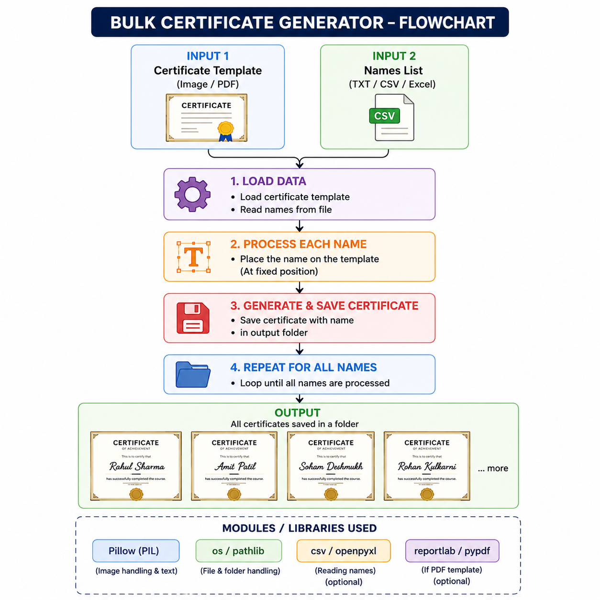

# 📜 Bulk Certificate Generator

A simple Python-based **Bulk Certificate Generator** that automatically creates personalized certificates for multiple students using a single certificate template.

Instead of manually editing a certificate for every participant, this project takes a list of student names, adds the required details to the template, and saves an individual certificate for each student.

## 🎯 Project Idea

Imagine a school competition with **100 students** participating.

Creating certificates manually would mean editing the certificate 100 times. This project automates that process:

```text
Certificate Template + Student Name List
                 ↓
           Python Program
                 ↓
       Personalized Certificates
                 ↓
      Output Folder
```

For example:

```text
Aarav Sharma
Riya Patil
Aditya Kulkarni
       ↓
Certificate Generator
       ↓
1. Aarav Sharma.png
2. Riya Patil.png
3. Aditya Kulkarni.png
```

## ✨ Features

- 🧑‍🎓 Generates certificates for multiple students
- 🖼️ Uses a customizable certificate template
- ✍️ Automatically adds the recipient's name
- 🏆 Adds achievement and competition/program details
- 📅 Automatically adds the issue date
- 🖊️ Adds a signature image
- 🔤 Supports custom fonts using Pillow
- 📁 Automatically saves generated certificates
- ⚡ Saves time compared with creating certificates manually

## 🛠️ Technologies Used

- **Python**
- **Pillow (PIL)** — image editing and text rendering
- **os** — file and folder management
- **datetime** — generating the current date

## 📂 Project Structure

```text
Certificate-Generator-by-soham/
│
├── project Files/
│   ├── fonts/
│   ├── certificate_template.png
│   ├── certification_template.png
│   ├── dummy_certificate_template.png
│   ├── main.py
│   └── signature.png
│
├── Coding Karo Competition-Certificates/
│   └── Generated certificates
│
├── idea.png
├── Bulk_Certificate_Generator_Description.txt
└── .gitignore
```

> The generated certificate folder is excluded from Git using `.gitignore`.

## ⚙️ How It Works

### 1. Certificate Template

A certificate template is provided as an image.

### 2. Student Names

The program uses a Python list containing student names:

```python
students = [
    "Aarav Sharma",
    "Riya Patil",
    "Aditya Kulkarni",
    "Ananya Deshmukh"
]
```

### 3. Text and Images

Using Pillow, the program places the required information at predefined coordinates on the certificate, such as:

- Student name
- Achievement
- Competition/program name
- Date
- Signature

### 4. Certificate Generation

A fresh copy of the template is created for every student. The personalized certificate is then saved separately.

## 🚀 Installation

Make sure Python is installed on your computer.

Install Pillow:

```bash
pip install Pillow
```

## ▶️ How to Run

Open the project in VS Code and run:

```bash
python "project Files/main.py"
```

Follow the instructions shown in the terminal.

Generated certificates will be saved inside:

```text
Coding Karo Competition-Certificates/
```

## 📝 Example

Suppose a school organizes an **Inter-School Drawing Competition** and the participants are:

```text
Aarav Sharma
Riya Patil
Aditya Kulkarni
Ananya Deshmukh
```

The program automatically generates:

```text
1. Aarav Sharma.png
2. Riya Patil.png
3. Aditya Kulkarni.png
4. Ananya Deshmukh.png
```

Each certificate contains the corresponding student's name while keeping the original certificate design.

## 📸 Project Preview



## 🔮 Future Improvements

- [ ] Read student names from a `.txt` file
- [ ] Read student data from Excel/CSV
- [ ] Add a graphical user interface (GUI)
- [ ] Allow users to select their own certificate template
- [ ] Allow users to select fonts and colors
- [ ] Automatically center text based on its width
- [ ] Export certificates as PDF
- [ ] Add multiple certificate templates
- [ ] Add better error handling for missing files and fonts

## 👨‍💻 Author

**Soham**

This project was created as a Python automation project to practice image processing, file handling, and automation.

## ⭐ If You Like This Project

If you find this project useful or interesting, consider giving the repository a ⭐ on GitHub!
